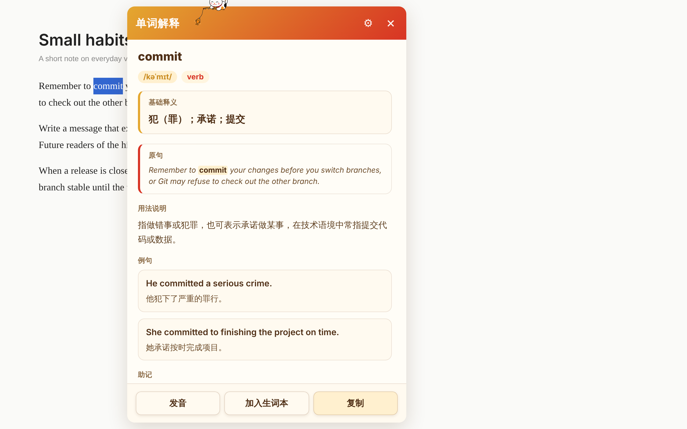
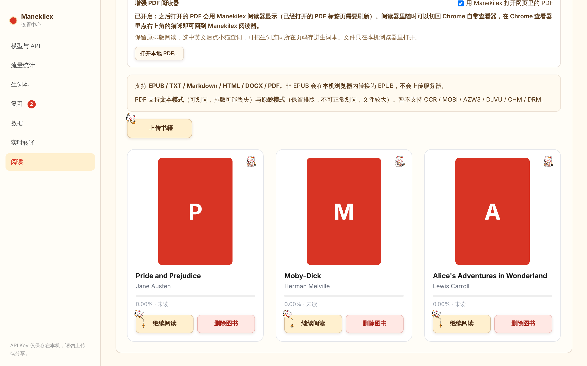
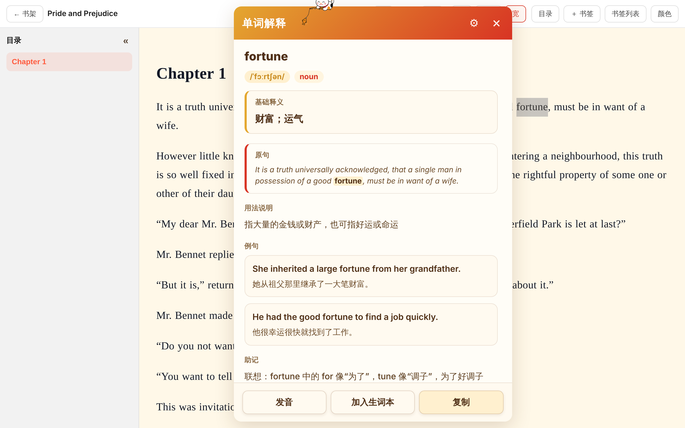
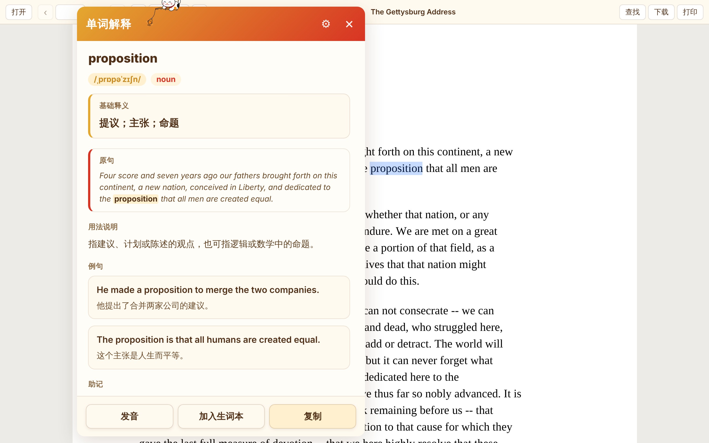
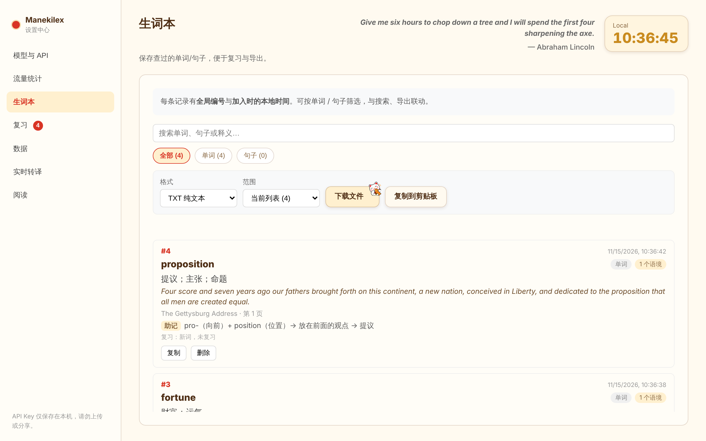
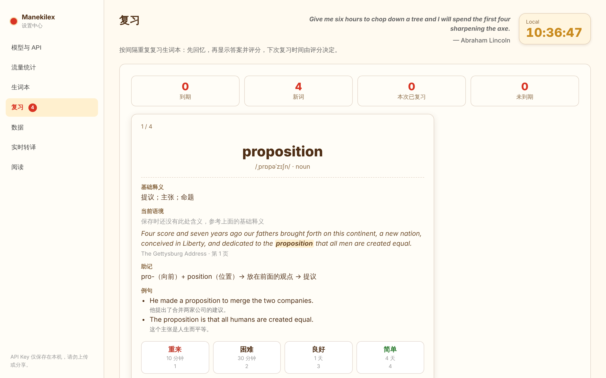
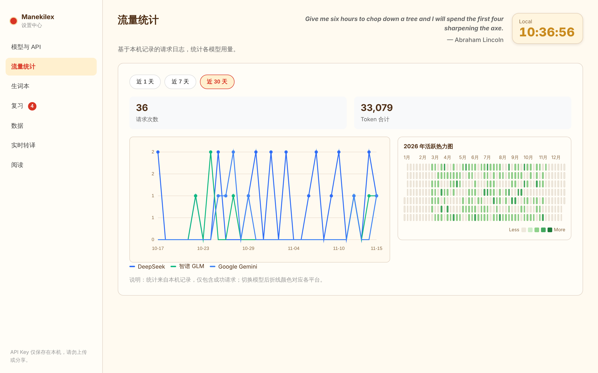
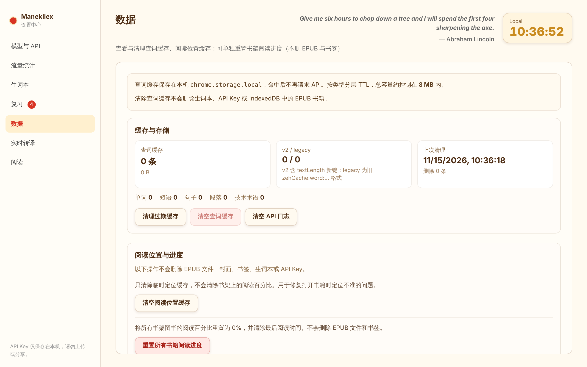
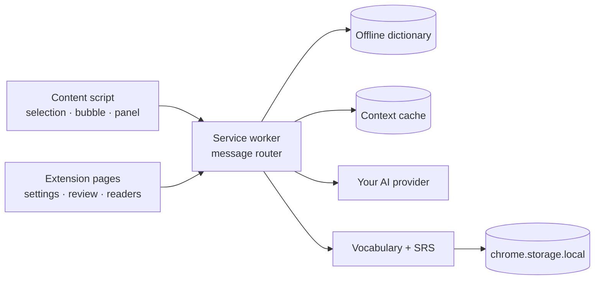

<div align="center">


# Manekilex

**Read in context. Keep what you learn.**

A Chrome extension for Chinese-speaking readers of English. Select a word while you read:<br>
Manekilex shows an offline dictionary entry at once, then explains what the word means in **this** sentence.

[](https://developer.chrome.com/docs/extensions/develop/migrate/what-is-mv3)
[](#architecture)
[](#license-and-attribution)
<!-- Enable after the first green CI run on the new snapshot:
[](https://github.com/Zamp0x0/Manekilex/actions/workflows/ci.yml)
-->

[Preview](#product-preview) · [Features](#core-features) · [Reading](#reading-experience) · [Learning](#vocabulary-and-learning) · [Data](#analytics-and-data-management) · [Engineering](#engineering-highlights) · [Quick start](#quick-start) · [Feature tour](./docs/SHOWCASE.md)

</div>

> **中文简介**：Manekilex 帮助中文读者读英文。选中一个词，先显示本地词典释义，再解释它在这句话里的意思。内置书架、EPUB 阅读器和增强 PDF 阅读器；查过的词连同原句进入生词本，按间隔重复复习；用量统计和缓存都在本机，随时可查看、可清理。界面为简体中文。

## Product preview

<p align="center">
  
</p>

<sub>All screenshots are real, taken from version 0.11.1 in Chrome with no API key and no network access, so lookup panels show the instant offline-dictionary view. With a key configured, the same panel also gains a "meaning in this sentence" section. Book text is public domain; the web page was written for the screenshots. More in the [feature tour](./docs/SHOWCASE.md).</sub>

## Why Manekilex?

A dictionary lists every meaning of a word; a reader needs the one that fits the sentence. The bundled dictionary gives *commit* as 犯（罪）；承诺；提交:

| Sentence | The sense that fits |
| --- | --- |
| Remember to **commit** your changes before you switch branches. | 提交: save to version control |
| The team would not **commit** to a release date. | 承诺: promise |
| He was accused of **committing** fraud. | 犯（罪）: carry out a crime |

Manekilex sends the word with its sentence to the AI provider you choose and adds the sense that fits, a translation of the sentence and related words. A [frozen benchmark](#word-sense-evaluation) measures exactly this. Around that lookup sits everything a reader needs: books, PDFs, a vocabulary with the original sentences, and daily review.

## Core features

**Understand words in context.**

- **Select and click.** Select English text on a web page, in a book or in a PDF, and an orange bubble appears. Click it to open the lookup panel. Words, phrases, sentences and paragraphs each get their own kind of explanation.
- **Offline first.** 25,518 dictionary entries ship with the extension, so word and phrase lookups appear at once, even with no network or API key: phonetics, core meaning, the original sentence, usage notes, examples and a memory tip.
- **Meaning in this sentence.** With an AI provider configured, the panel adds the sense that fits the sentence, a sentence translation and related words.
- **Your choice of AI provider.** Bring your own key for OpenAI, DeepSeek, Moonshot (Kimi), Zhipu GLM, SiliconFlow, Groq or Google Gemini. A built-in speed test compares providers on fixed sample lookups.
- **Right-click and on/off.** A right-click **Look up** item opens the result in Chrome's side panel, and a switch in the toolbar popup turns Manekilex on or off.

**Also included.** Optional live transcription: real-time English captions from your microphone or a browser tab (AssemblyAI, your own key), translated into Chinese by the model you choose, with bilingual export. See the [feature tour](./docs/SHOWCASE.md#live-transcription-and-translation).

## Reading experience

**Read without leaving your workflow.**

| Personal bookshelf | EPUB reader | Enhanced PDF reader |
| :---: | :---: | :---: |
|  |  |  |

- **Bookshelf.** Your books live in the extension, with covers, reading progress, renaming and drag-to-reorder. Files stay on your computer.
- **EPUB reader.** Table of contents, bookmarks, saved reading progress, font size, line width and page colours.
- **PDF reader.** Original layout with page navigation, zoom, find, download and print. On Chrome 151 and later, PDFs you open on the web can open here automatically; Chrome's own viewer is one click away.
- **Local conversion.** TXT, Markdown, HTML, DOCX and PDF files are converted to EPUB inside your browser. PDFs import as selectable text or keep their original look.

## Vocabulary and learning

**Turn reading into long-term learning.**

| Vocabulary with sentence contexts | Spaced-repetition review |
| :---: | :---: |
|  |  |

- **Save with context.** One click saves a word with the sentence and its source: a web page, a book, or a PDF and its page. One word keeps up to eight contexts.
- **Find and export.** Search and filter the list, then export it as TXT, CSV or Markdown.
- **Review.** Recall first, then reveal and rate Again, Hard, Good or Easy; each button shows when the card returns. A simplified SM-2-style scheduler sets the next date, and the keyboard works too.

## Analytics and data management

**Stay in control of your data.**

| Usage analytics | Data and cache management |
| :---: | :---: |
|  |  |

<sub>Illustrative analytics populated with synthetic local usage records. No real model requests or API charges were generated.</sub>

- **Usage analytics.** Requests and tokens per provider for the last day, 7 days or 30 days, a daily request chart and a full-year activity heatmap, all from records kept on your computer.
- **Cache you can see.** The lookup cache is counted by type (word, phrase, sentence, paragraph, technical term), expires by type and stays within about 8 MB.
- **Clean up any time.** Clear expired entries, the whole cache or the usage log, or reset reading positions and progress, without touching your vocabulary, keys or books.

**Privacy at a glance.**
- **No servers.** Manekilex has no backend, analytics service or telemetry.
- **What a lookup sends.** The selected text and its sentence go to the provider you configured. Page URLs and titles are not sent.
- **Your API key** is stored unencrypted in `chrome.storage.local` and sent only to that provider's endpoint.
- **Where it runs.** The content script runs on the ordinary web pages that Chrome lets extensions access. Chrome's internal `chrome://` pages and the Chrome Web Store are not supported.

Details: [docs/PRIVACY.md](./docs/PRIVACY.md) (draft, in Chinese and English).

## Engineering highlights

### Word-sense evaluation

A frozen benchmark of 60 polysemous words, each in two sentences that use different senses (120 sentences in all), was split by word into Dev and Held-out sets before any model run.

| | Context-aware lookup | Dictionary first sense |
| --- | --- | --- |
| Dev, 36 sentences | **36 / 36** | 17 / 36 |
| Held-out, 84 sentences | **84 / 84** (95% CI 95.6–100%) | 38 / 84 |

How to read this:
- **The dictionary baseline.** A context-free answer can be right at most half the time on this design.
- **Who set the labels.** The Held-out labels were set by two separate LLM judges. They were not human-verified, and the judges come from the same model family that helped draft the gold labels.
- **Strategy, not sole cause.** The context-aware product strategy outperformed the dictionary first-sense baseline on this benchmark. The methods also differ in prompts and output formats, so the experiment does not isolate context as the sole causal factor. It is not a measure of real-world accuracy either.

Method, subgroups and limits: [docs/EVALUATION.md](./docs/EVALUATION.md).

### Performance, benchmarked

| Dictionary lookup | Service-worker cold start | Real AI request (median) |
| :---: | :---: | :---: |
| ≈ 60 ms median | ≈ 35 ms | 2.0 s Held-out · 2.5 s Dev |

The first two come from `npm run perf` in headless Chromium with the model stubbed; the AI latency comes from the evaluation runs.

### Reliable spaced repetition

Ratings must not double-count, even with two tabs open or after the service worker restarts:
- **Serialized writes.** Only the service worker writes the vocabulary.
- **Optimistic version check.** Every rating carries the review count it expects; a mismatch is refused as *stale*.
- **Persisted state.** Review state is saved in `chrome.storage.local`, so saved progress is restored after a worker restart, and the version check stops a stale rating from being applied twice.

Real-Chrome tests of four cases (duplicate submit, two tabs at once, two tabs in turn, worker stopped) failed 2 of 4 before a fix to the review page, then passed in five consecutive runs.

<details>
<summary>More under the hood</summary>

- The cache key includes the sentence, so the same word in another sentence is looked up again.
- Identical lookups in flight share one request.
- Late answers for a word the reader has moved past are dropped.
- Scripts injected into web pages may send only six message types. Deleting data, rating reviews and changing providers are accepted only from the extension's own pages.
- Page scripts cannot trigger a lookup with synthetic clicks.
</details>

## Quick start

Manekilex is not on the Chrome Web Store yet. It installs as an unpacked extension on desktop Chrome.

1. Clone the repository, or download the ZIP and extract it.
2. Open `chrome://extensions`, turn on **Developer mode**, click **Load unpacked** and choose the folder.
3. *(Optional)* Click the toolbar icon, choose **打开设置中心** (Open settings) and then **模型与 API** (Models & API). Paste your key and enable one provider.
4. Select an English word on a web page and click the orange bubble.
5. Click **加入生词本** (Add to vocabulary), then review under **复习** (Review) in Settings. Add books under **阅读** (Reading).

<details>
<summary>Development</summary>

```bash
npm ci                # one dev dependency (csv-parse); Node 20+, CI uses 22
npm run check         # syntax, manifest, dictionary and repository hygiene
npm test              # offline unit tests, no paid API calls
npm run test:browser  # the real extension in Chrome via Playwright; model calls are stubbed
npm run perf          # the performance baseline
```

Browser-test setup: [CONTRIBUTING.md](./CONTRIBUTING.md).
</details>

## Architecture



Books and reading progress live in IndexedDB. Full design: [docs/ARCHITECTURE.md](./docs/ARCHITECTURE.md) (Chinese).

| Layer | Used |
| --- | --- |
| Platform | Chrome Extensions, Manifest V3: service worker, content scripts, side panel |
| Code | Vanilla JavaScript, HTML and CSS, with no framework and no build step |
| Storage | `chrome.storage.local`, IndexedDB |
| Reading | epub.js, PDF.js, JSZip, mammoth.js, marked (vendored in `lib/`) |
| AI | OpenAI-compatible Chat Completions and Gemini `generateContent`, called over HTTPS |
| Testing | Node.js test runner, Playwright-driven Chrome, GitHub Actions |

## Documentation

[Feature tour](./docs/SHOWCASE.md) · [Architecture](./docs/ARCHITECTURE.md) · [Evaluation](./docs/EVALUATION.md) · [Privacy](./docs/PRIVACY.md) · [Security](./SECURITY.md) · [Contributing & testing](./CONTRIBUTING.md) · [Release process](./docs/RELEASE.md) · [Data sources](./data/README.md)

## License and attribution

- **Code.** Manekilex's own code is under the [MIT License](./LICENSE), © 2026 Zamp.
- **Libraries.** The libraries in `lib/` keep their own licences, listed in [THIRD_PARTY_NOTICES.md](./THIRD_PARTY_NOTICES.md).
- **Dictionary.**
  - Chinese meanings and word forms come largely from [ECDICT](https://github.com/skywind3000/ECDICT) (MIT).
  - The examples and memory tips are AI-generated and may contain mistakes.
  - The word-frequency list derives from [wordfreq](https://github.com/rspeer/wordfreq) (CC BY-SA 4.0).
  - Details are in [data/README.md](./data/README.md).
- **Mascot and icons.** The author made them with an AI image tool. They are not covered by the MIT License.
