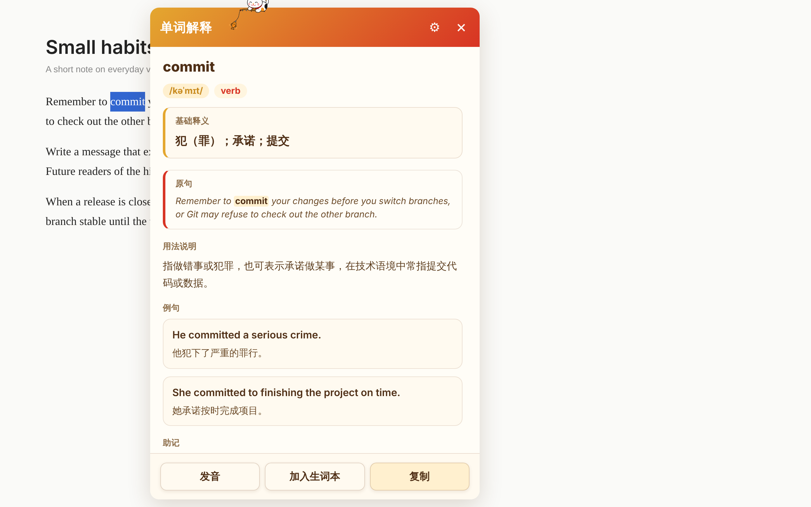
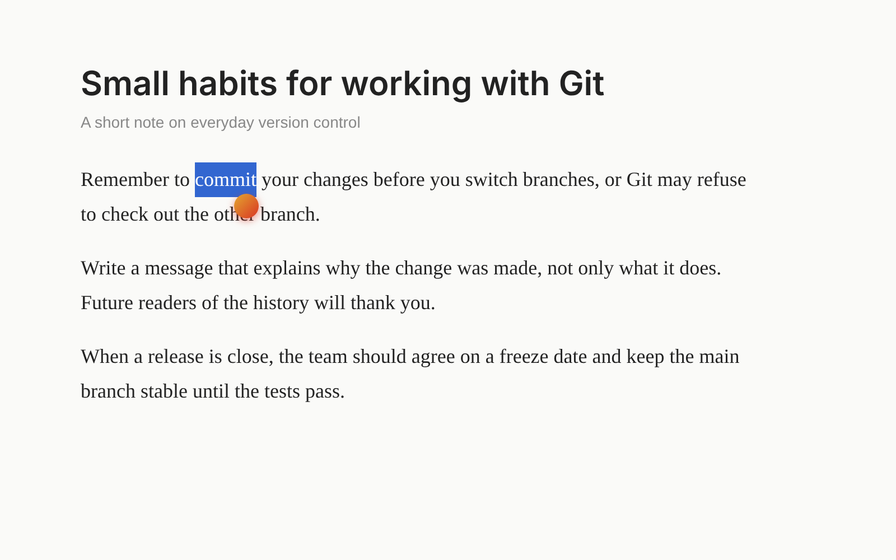
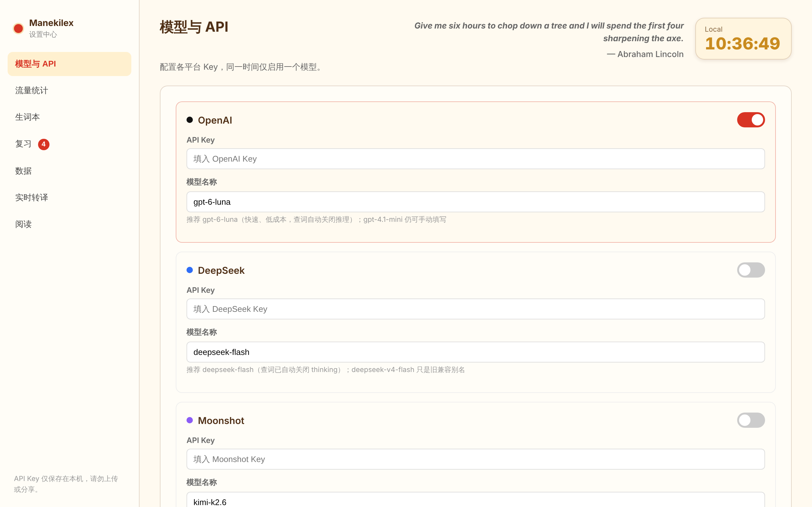
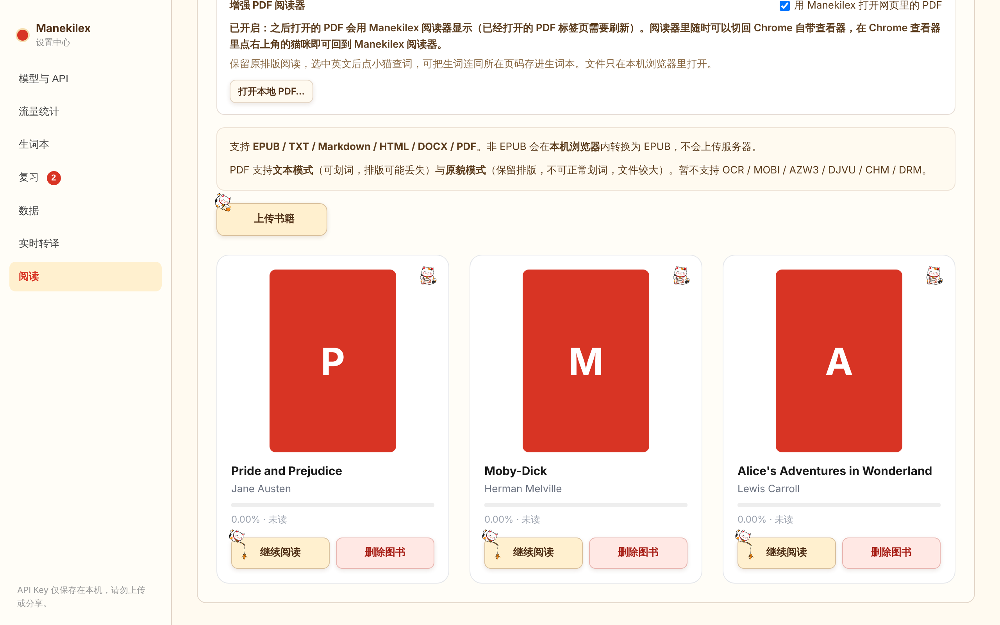
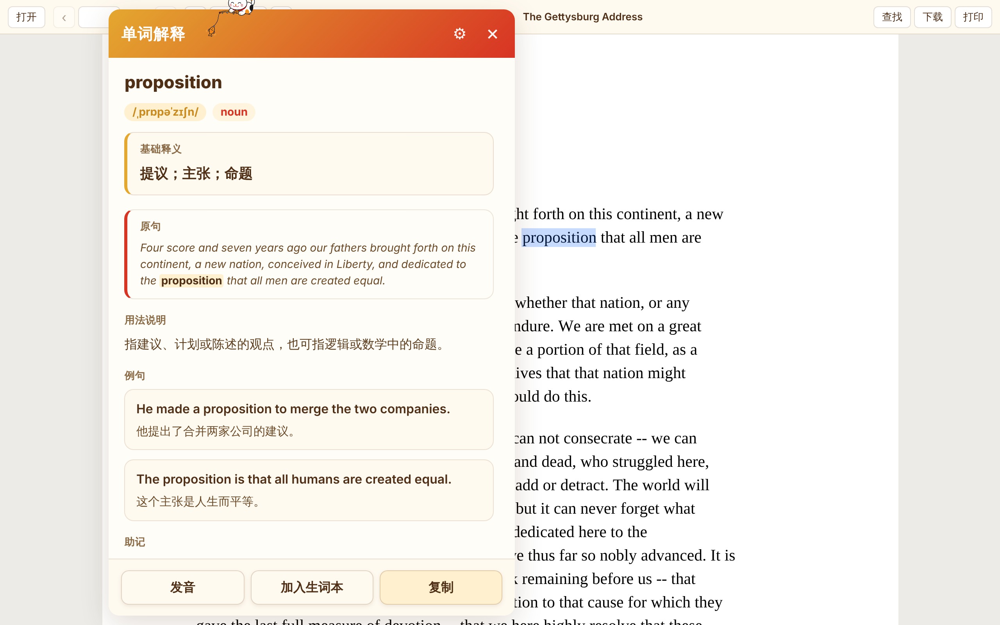
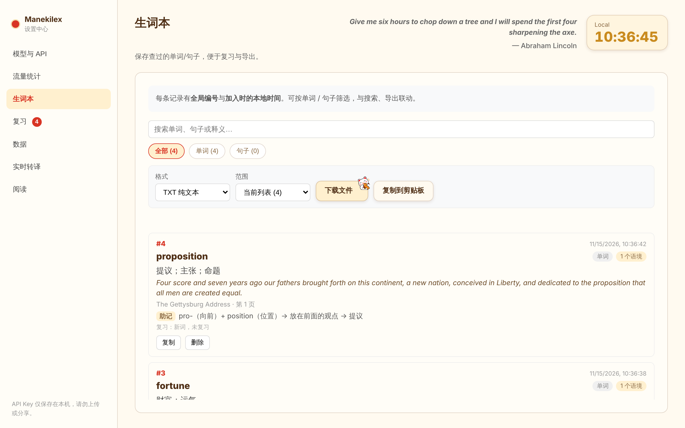
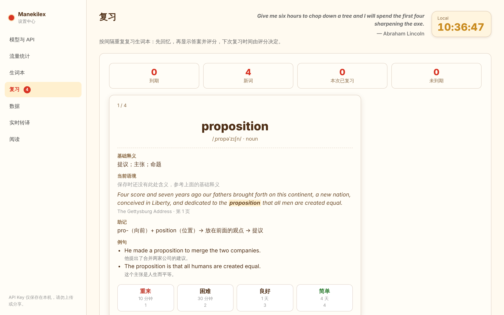
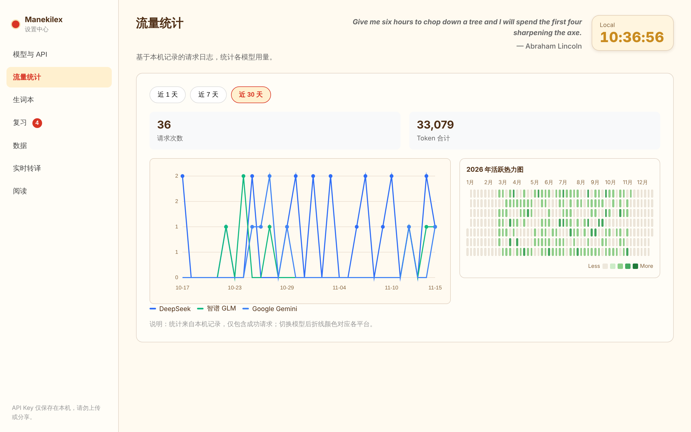
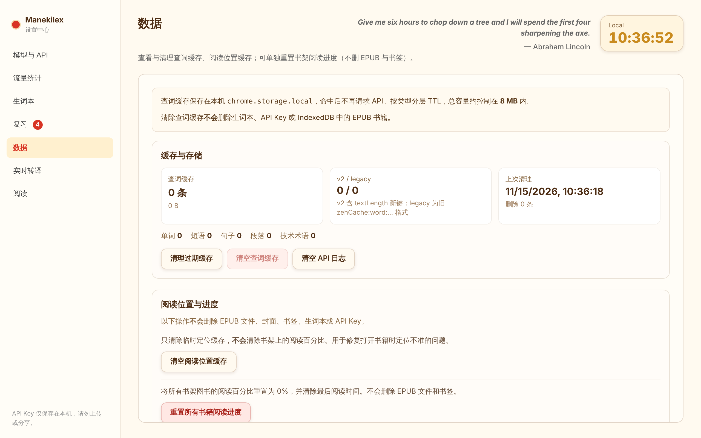
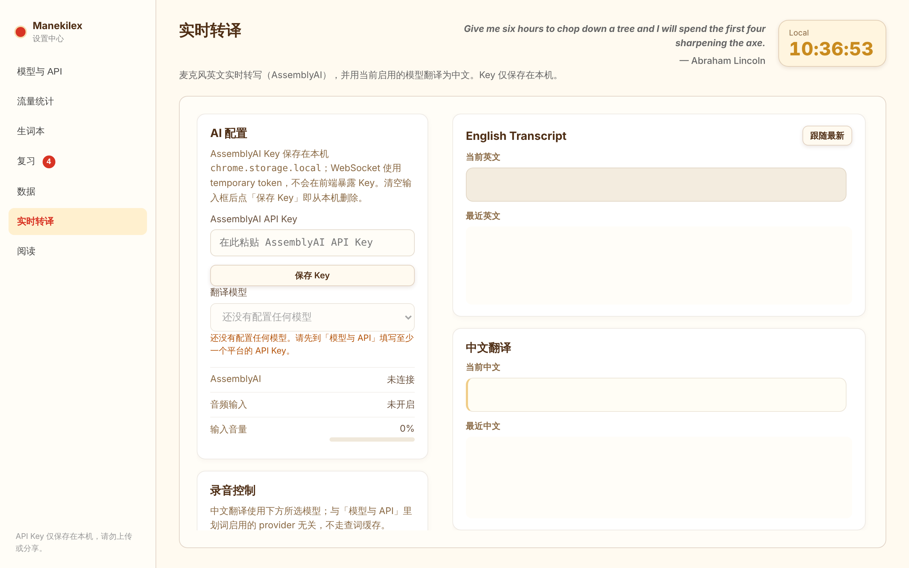

# Manekilex feature tour

Manekilex helps Chinese-speaking readers read English on the web, in books and in PDFs. You select a word and see what it means; you keep the words you meet and review them later. Everything is stored in your own browser.

This page walks through every feature that ships in version 0.11.1. Back to the [README](../README.md).

**About the screenshots.** All eleven are real screenshots of the extension running in Chrome. No API key was configured and the browser had no network access, so lookup panels show the instant offline-dictionary view and no AI output appears anywhere. Book text comes from public-domain works; the web page was written for the screenshots. The usage screenshot shows illustrative analytics populated with synthetic local usage records; no real model requests or API charges were generated.

**Contents**

1. [Understand words in context](#1-understand-words-in-context): [lookup](#context-aware-lookup), [offline dictionary](#offline-dictionary), [AI providers](#your-choice-of-ai-provider)
2. [Read without leaving your workflow](#2-read-without-leaving-your-workflow): [bookshelf](#personal-bookshelf), [EPUB reader](#epub-reader), [PDF reader](#enhanced-pdf-reader), [file conversion](#local-file-conversion)
3. [Turn reading into long-term learning](#3-turn-reading-into-long-term-learning): [vocabulary](#vocabulary-with-sentence-contexts), [spaced repetition](#spaced-repetition)
4. [Stay in control of your data](#4-stay-in-control-of-your-data): [usage analytics](#usage-analytics), [data and cache management](#data-and-cache-management)
5. [Also included](#5-also-included): [live transcription and translation](#live-transcription-and-translation)

---

## 1. Understand words in context

### Context-aware lookup

A dictionary lists every meaning of a word, but a reader needs the one that fits the sentence. Manekilex looks at the sentence you are reading and explains the word as it is used there.

**What it does**
- Select English text and a small orange bubble appears next to it. Click the bubble to open the lookup panel.
- The panel opens at once with the offline dictionary entry: phonetics, part of speech, the core meaning, the sentence you selected from, a usage note, example sentences, a memory tip and common collocations.
- With an AI provider configured, the panel adds the meaning in this sentence, a translation of the sentence and related words.
- Words, phrases, sentences and paragraphs each get their own kind of explanation.
- It works on ordinary web pages, in the built-in EPUB reader and in the enhanced PDF reader.
- The right-click menu has **Manekilex 查词「…」** (Look up) for selected text, which opens the result in Chrome's side panel.
- Panel buttons read the word aloud, add it to your vocabulary or copy the explanation.
- The toolbar popup has a switch that turns Manekilex on or off.

**How to use it.** Select a word on any page, then click the orange bubble. Chrome does not let extensions run on `chrome://` pages or the Chrome Web Store.

### Offline dictionary

The first answer never waits for the network. A dictionary ships inside the extension, so you can look up words with no connection and no API key.

**What it does**
- 25,518 entries, each with Chinese meanings, phonetics, part of speech, examples, a memory tip and collocations.
- Word and phrase lookups show the dictionary result first, before any AI request.
- Inflected forms such as *committing* are matched to their dictionary entry.

**How to use it.** Nothing to set up. The dictionary is part of every lookup.

### Your choice of AI provider

You bring your own key and pick the model. Manekilex has no server of its own; requests go straight from your browser to the provider you choose.

**What it does**
- Seven providers: OpenAI, DeepSeek, Moonshot (Kimi), Zhipu GLM, SiliconFlow, Groq and Google Gemini.
- Each provider has its own key and model name, with a recommended default model filled in. One provider is active at a time.
- A built-in speed test compares providers on fixed sample lookups (quick, standard or full run) and can export the results as JSON. It runs only when you start it and uses your own keys.

**How to use it.** Click the toolbar icon, choose **打开设置中心** (Open settings) and then **模型与 API** (Models & API). Paste a key, switch the provider on, and look up a word.

---

## 2. Read without leaving your workflow

### Personal bookshelf

Keep the books you are reading inside the extension, next to your dictionary and vocabulary.

**What it does**
- Every imported book appears as a card with its cover (or its initial), title, author and reading progress.
- Rename a book, drag cards to reorder the shelf, or delete a book.
- Books are stored on your computer in the browser's IndexedDB and never uploaded.

**How to use it.** Open Settings → **阅读** (Reading). Click **上传书籍** (Upload book) to add a file, then **继续阅读** (Continue reading) to open it.

### EPUB reader

A clean reading view where every word is one selection away from an explanation.

**What it does**
- Table of contents in a side panel that you can collapse.
- Bookmarks: add one at the current position and jump back from the bookmark list.
- Reading progress is saved, so a book reopens where you stopped.
- Font size, line width (narrow, standard or wide) and several page colours.
- The same lookup panel as on the web; saved words remember the book they came from.

**How to use it.** Open a book from the bookshelf. Select a word in the text and click the bubble.

### Enhanced PDF reader

Read PDFs with their original layout and look words up without converting anything.

**What it does**
- Keeps the original page layout, with page navigation, zoom, find in document, download and print.
- Select English text and click the bubble for the same lookup panel. A saved word records the PDF and the page number.
- On Chrome 151 and later, PDFs you open on the web can open in this reader automatically. You can switch back to Chrome's own viewer at any time.
- Local PDF files open in the browser only; nothing is uploaded.

**How to use it.** Settings → **阅读** (Reading) → **打开本地 PDF…** (Open local PDF). On Chrome 151+, turn on **用 Manekilex 打开网页里的 PDF** (Open web PDFs with Manekilex) on the same page.

### Local file conversion

Bring your own reading material in common formats and read it in the EPUB reader.

**What it does**
- Converts TXT, Markdown, HTML, DOCX and PDF files to EPUB, on your computer, inside the browser.
- PDFs import in **text mode** (selectable text; the layout may change) or **original-look mode** (layout kept as page images; words cannot be selected normally).
- A progress bar shows the import, and you can cancel it.
- Not supported: OCR of scanned pages, MOBI, AZW3, DJVU, CHM and DRM-protected files.

**How to use it.** Settings → **阅读** (Reading) → **上传书籍** (Upload book), then choose a file. A PDF asks which mode to use.

---

## 3. Turn reading into long-term learning

### Vocabulary with sentence contexts

A word is easier to remember together with the sentence where you met it. Manekilex saves both.

**What it does**
- Save a word or sentence from any lookup panel with **加入生词本** (Add to vocabulary).
- Each entry keeps the original sentence and where it came from (a web page, a book, or a PDF and its page). One word keeps up to eight different contexts.
- Search across words, sentences and meanings; filter by words or sentences.
- Export the current list or everything as TXT, CSV or Markdown, as a download or to the clipboard.
- Each entry shows its review state, so you can see what is new and what is learned.

**How to use it.** Settings → **生词本** (Vocabulary).

### Spaced repetition

Short daily reviews, scheduled for you, turn looked-up words into words you know.

**What it does**
- Recall first, then reveal the answer: the meaning, the sentence you saved, a memory tip and examples.
- Rate each card **重来 / 困难 / 良好 / 简单** (Again, Hard, Good, Easy). Each button shows when the card will come back.
- A simplified SM-2-style scheduler sets the next review date.
- Counters show cards due, new cards, cards reviewed in this session and cards not yet due. A badge on the **复习** (Review) menu item shows the size of the next session: cards due plus up to 20 new words.
- Keyboard: Space or Enter reveals the answer, 1 to 4 rates it.
- Saved review progress is restored after the service worker restarts, and a version check stops a stale rating from being applied twice, even with two tabs open (see [Reliable spaced repetition](../README.md#reliable-spaced-repetition)).

**How to use it.** Settings → **复习** (Review) → **开始复习** (Start review).

---

## 4. Stay in control of your data

### Usage analytics

See how much you use each AI provider and what it costs in tokens, from records kept only on your computer.

Illustrative analytics populated with synthetic local usage records. No real model requests or API charges were generated.

**What it does**
- Request count and total tokens for the last day, 7 days or 30 days.
- A line chart of daily requests with one line per provider; hover a point to see the requests and tokens for that day.
- A full-year activity heatmap shaded by tokens used per day.
- Counts only successful requests; the most recent 500 records are kept.

**How to use it.** Settings → **流量统计** (Usage). Settings opens on this page by default.

### Data and cache management

Every cache is visible and every one can be cleared, without touching your vocabulary, keys or books.

**What it does**
- Shows the lookup cache: number of entries, size, and counts for words, phrases, sentences, paragraphs and technical terms.
- Cached explanations expire by type (words and phrases after 30 days, sentences after 14, paragraphs after 7), and the cache stays within about 8 MB.
- Clean expired entries, clear the whole lookup cache, or clear the API usage log.
- Clear the reading-position cache, or reset the reading progress of every book, without deleting books or bookmarks.

**How to use it.** Settings → **数据** (Data).

---

## 5. Also included

### Live transcription and translation

Optional: follow spoken English from your microphone or a browser tab, with a Chinese translation alongside.

**What it does**
- Transcribes English speech in real time with AssemblyAI, from the microphone or from the sound of the current tab.
- Translates into Chinese with a model you choose: a precise mode that translates finished sentences, or a subtitle mode that updates both languages as people speak.
- Adjustable sentence-break speed, a "follow latest" view, and a button to translate the current sentence.
- Copy the bilingual text, or export an English or bilingual document.
- Needs your own AssemblyAI key and a configured translation model. Nothing runs until you start recording.

**How to use it.** Settings → **实时转译** (Live transcription). For tab audio, open the page you want, click the toolbar icon and choose **捕获当前标签页声音** (Capture this tab's audio).
